# Hướng dẫn sử dụng hệ thống QLTV (bản demo)

Tài liệu này hướng dẫn từng bước các chức năng chính của hệ thống quản lý thư viện QLTV, kèm ảnh chụp màn hình thực tế. Giao diện hệ thống bằng tiếng Anh nên tên nút và menu trong tài liệu được giữ nguyên tiếng Anh.

## 1. Chuẩn bị

Khởi động hệ thống bằng Docker (xem [README](../../README.md)), sau đó mở trình duyệt tại **http://localhost:5173**.

Hai tài khoản dùng để demo:

| Vai trò | Tên đăng nhập | Mật khẩu | Quyền |
|---|---|---|---|
| Admin (thủ thư) | `admin` | `admin123` | Quản lý sách, độc giả, thể loại, phiếu mượn; xem thống kê và audit log |
| Member (độc giả) | `vana` | `member123` | Xem và tự mượn sách, xem và tự trả sách của mình |

Khách chưa đăng nhập vẫn xem và tìm kiếm được danh mục sách.

## 2. Đăng nhập

1. Mở trang đăng nhập, nhập tên đăng nhập và mật khẩu.

   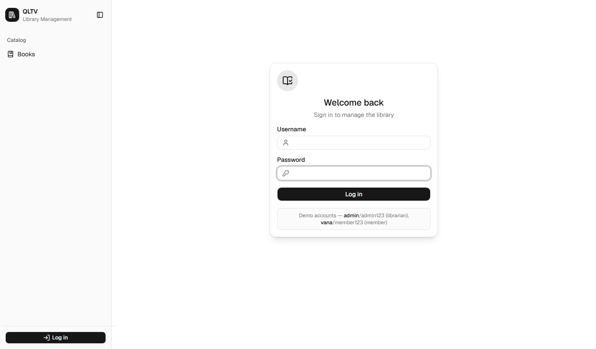

2. Nhập `admin` / `admin123` rồi bấm **Log in**.

   

3. Đăng nhập thành công, hệ thống chuyển về trang **Books**. Menu bên trái hiển thị thêm nhóm **Management** vì đây là tài khoản admin.

   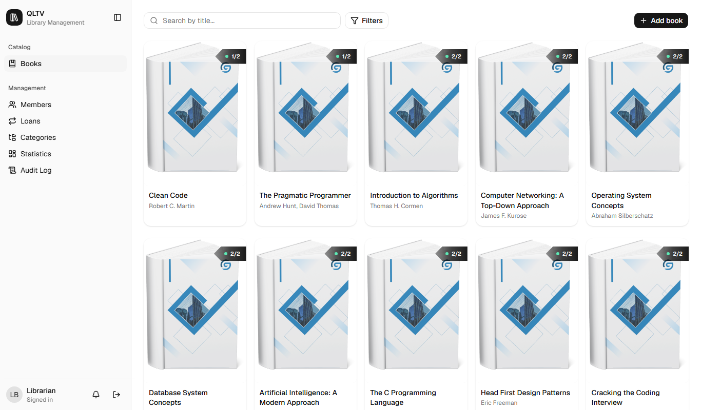

## 3. Chức năng dành cho Admin

### 3.1. Tìm kiếm và lọc sách

- Gõ tên sách vào ô **Search by title**. Hệ thống dùng tìm kiếm toàn văn (PostgreSQL full-text search) nên trả kết quả ngay khi bạn ngừng gõ.

  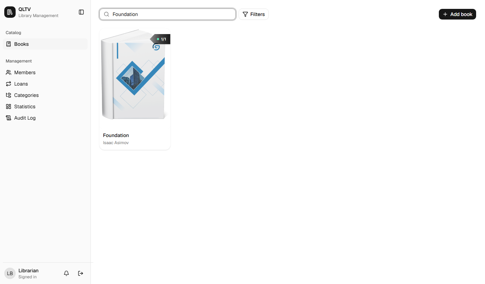

- Bấm **Filters** để lọc theo thể loại, chỉ hiện sách còn có thể mượn (**Available to borrow only**) hoặc đổi cách sắp xếp.

  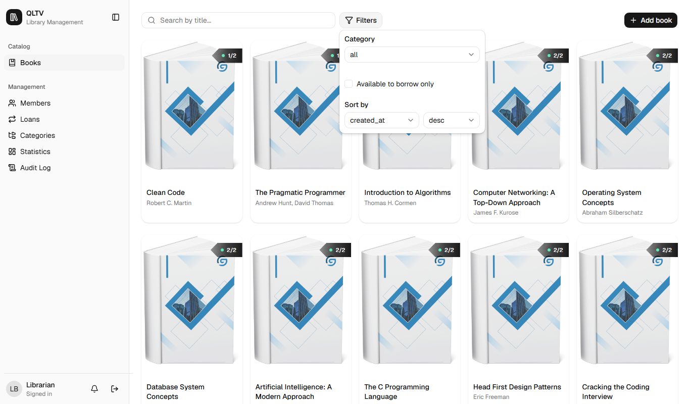

Nhãn ở góc mỗi bìa sách (ví dụ `2/2`) cho biết số bản sao còn rảnh trên tổng số bản sao.

### 3.2. Thêm sách mới

1. Bấm **Add book**.
2. Điền **Title**, **ISBN**, chọn **Category**, tick một hoặc nhiều tác giả ở mục **Authors**, nhập **Number of copies** (số bản sao ban đầu). Có thể bấm **Upload cover** để thêm ảnh bìa; nếu bỏ qua, hệ thống tự vẽ bìa từ chữ cái đầu của tên sách.
3. Bấm **Save**.

   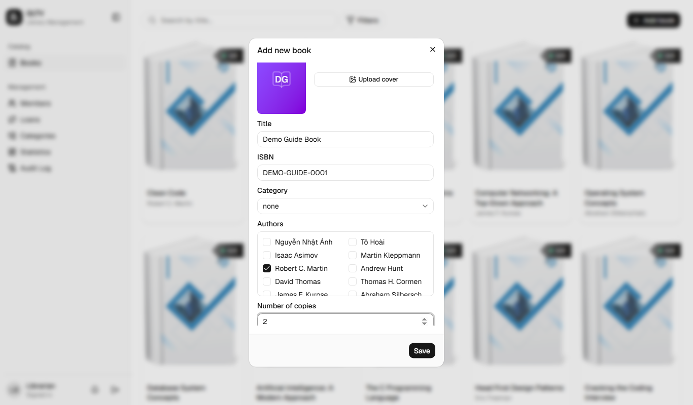

Sách mới xuất hiện ngay trong danh mục.

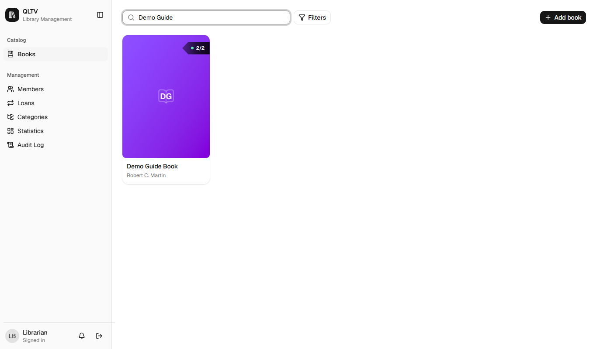

### 3.3. Sửa sách và quản lý bản sao

Rê chuột lên một cuốn sách, bấm nút **Edit** (hình bút). Hộp thoại cho phép sửa thông tin, đổi tác giả, thêm bản sao mới (**Add more copies**). Kéo xuống cuối hộp thoại còn có mục **Manage copies** để đánh dấu từng bản sao là hỏng (damaged), mất (lost) hoặc khôi phục lại (Restore). Bản sao đang được mượn thì không đổi trạng thái được.

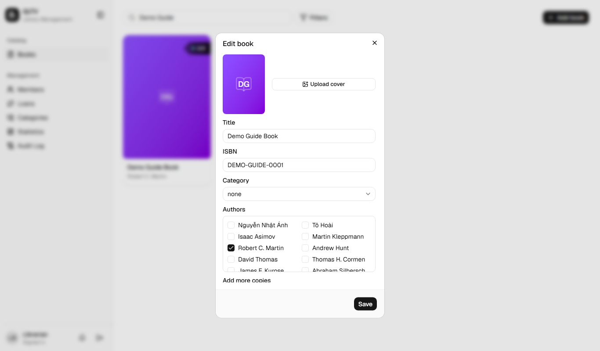

Để xóa sách, bấm nút **Delete** (hình thùng rác) trên sách. Sách đã từng có người mượn thì hệ thống từ chối xóa để giữ lịch sử.

### 3.4. Mượn sách hộ độc giả

Admin có thể ghi nhận việc mượn sách cho một độc giả. Rê chuột lên sách rồi bấm nút **Borrow**. Quy trình gồm 3 bước.

1. **Borrower**: bấm ô **Choose who is borrowing** và chọn độc giả.

   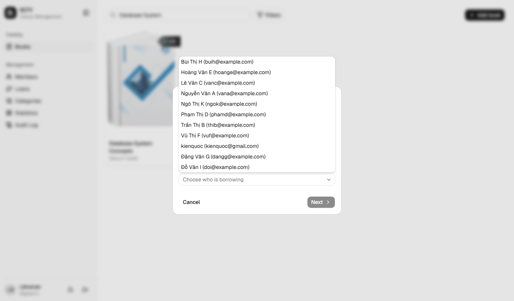

   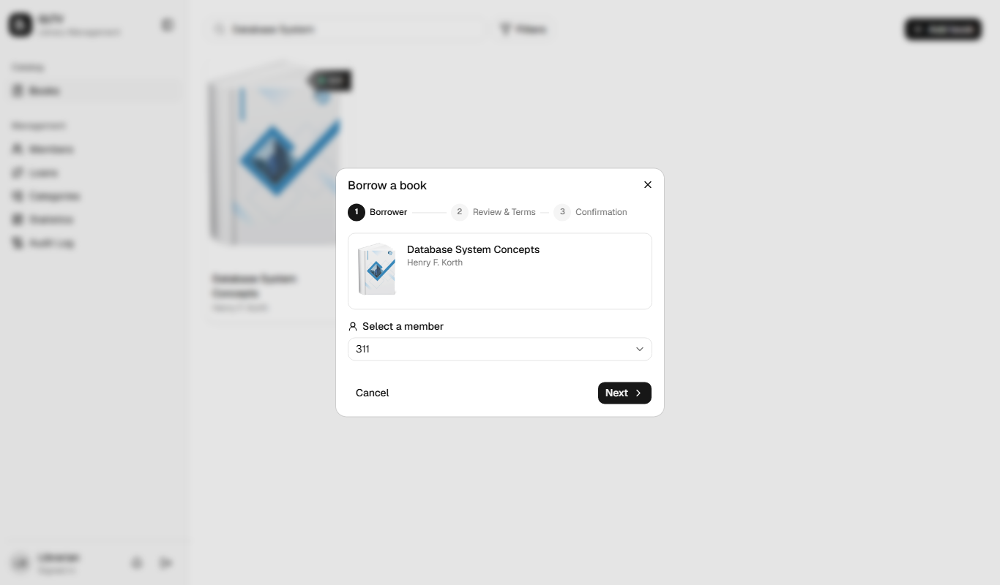

2. Bấm **Next** sang bước **Review & Terms**: xem hạn trả dự kiến và nội quy, tick đồng ý, rồi bấm **Confirm borrow**.

   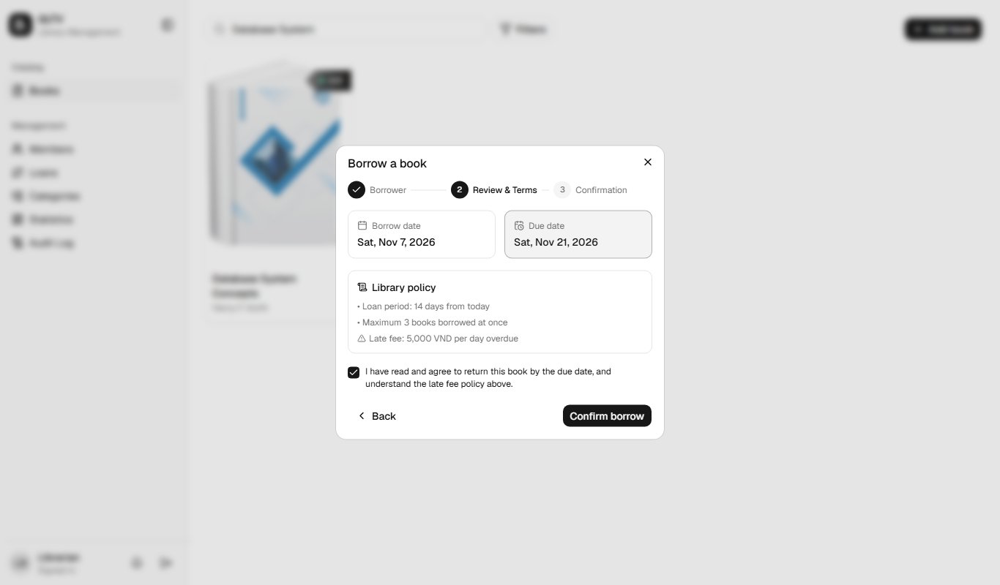

3. **Confirmation**: hệ thống hiển thị mã phiếu, trạng thái và hạn trả. Bấm **Done** để đóng.

   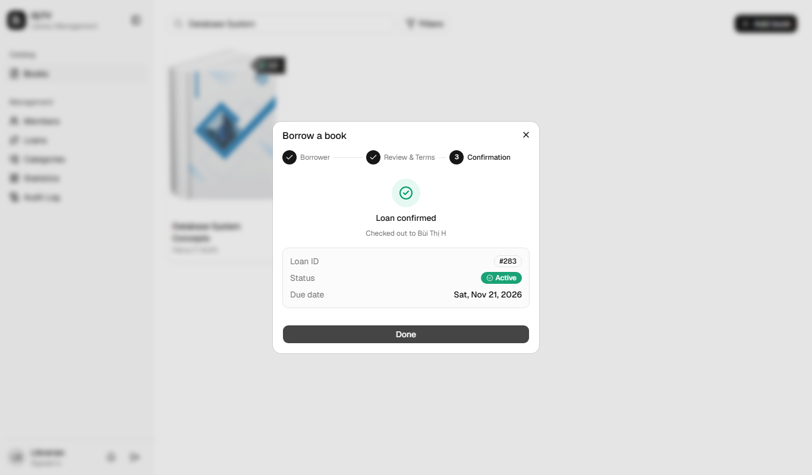

### 3.5. Quản lý độc giả (Members)

Trang **Members** liệt kê độc giả, có tìm kiếm, sắp xếp và phân trang.

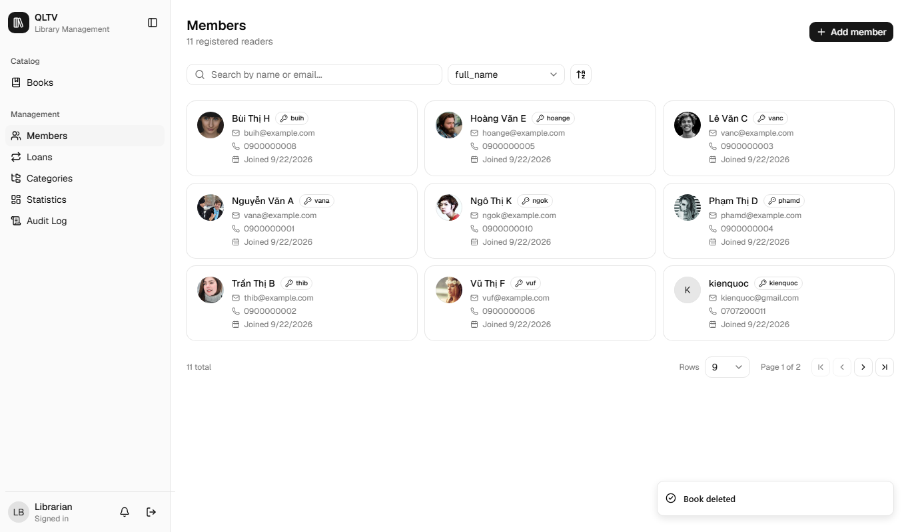

Bấm **Add member** để thêm độc giả: nhập họ tên, email, số điện thoại. Nếu điền thêm **Username**, hệ thống tạo luôn tài khoản đăng nhập cho độc giả đó (username tự gợi ý từ email, mật khẩu tự sinh). Mật khẩu chỉ hiển thị một lần ngay sau khi tạo, nhớ sao chép lại.

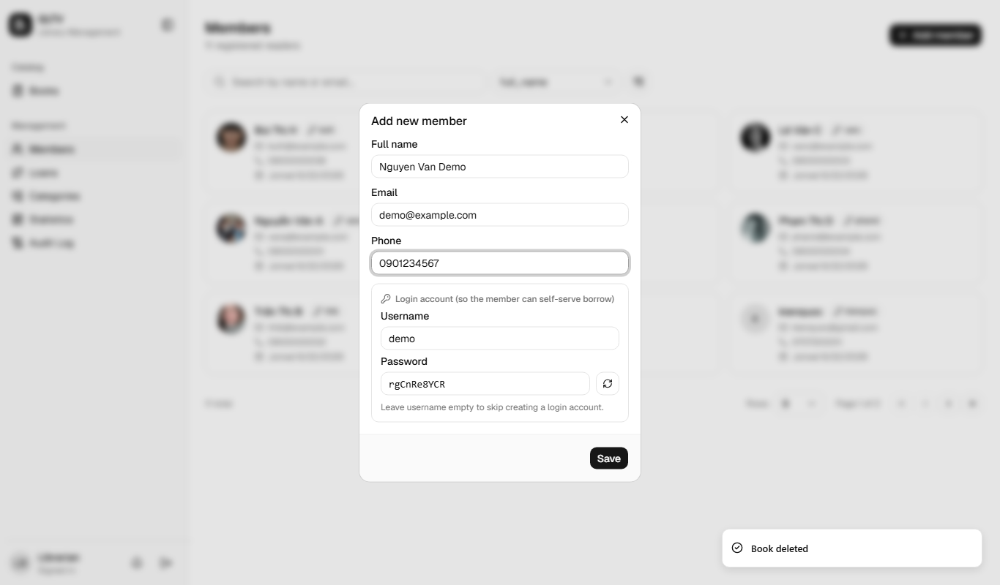

### 3.6. Quản lý thể loại (Categories)

Trang **Categories** cho phép tìm, thêm, sửa, xóa thể loại và đặt thể loại cha. Hệ thống không cho xóa thể loại còn thể loại con hoặc còn sách.

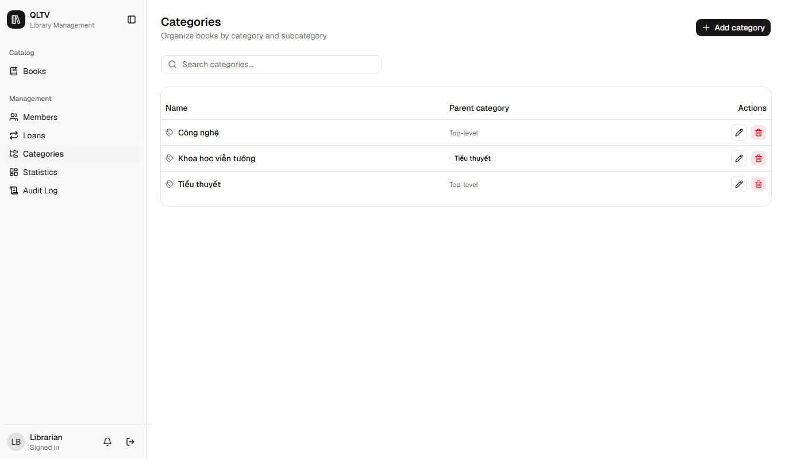

### 3.7. Quản lý phiếu mượn (Loans)

Trang **Loans** có hai tab:

- **Active**: các phiếu đang mượn.
- **Overdue**: các phiếu quá hạn, dữ liệu lấy từ view `v_overdue_loans` trong CSDL.

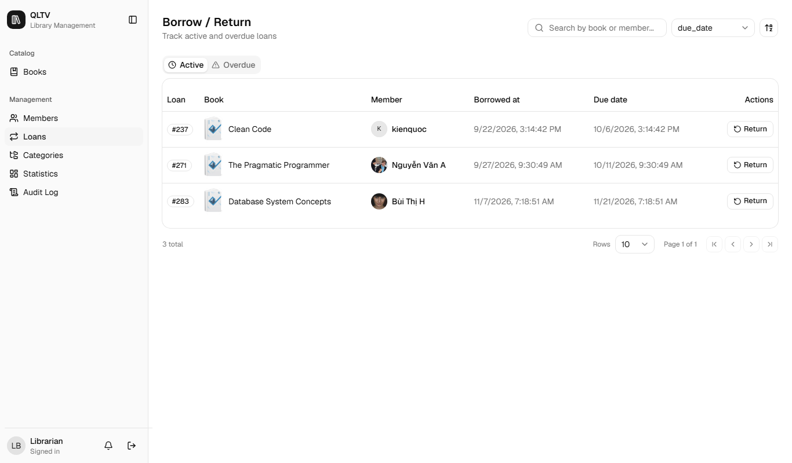

Bấm vào một dòng để xem chi tiết phiếu (sách, độc giả, ngày mượn, hạn trả).

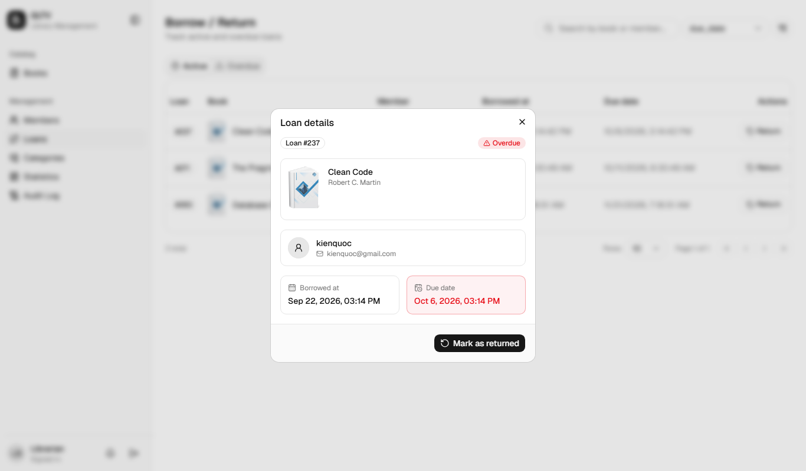

Tab **Overdue** cho biết mỗi phiếu đã trễ bao lâu.

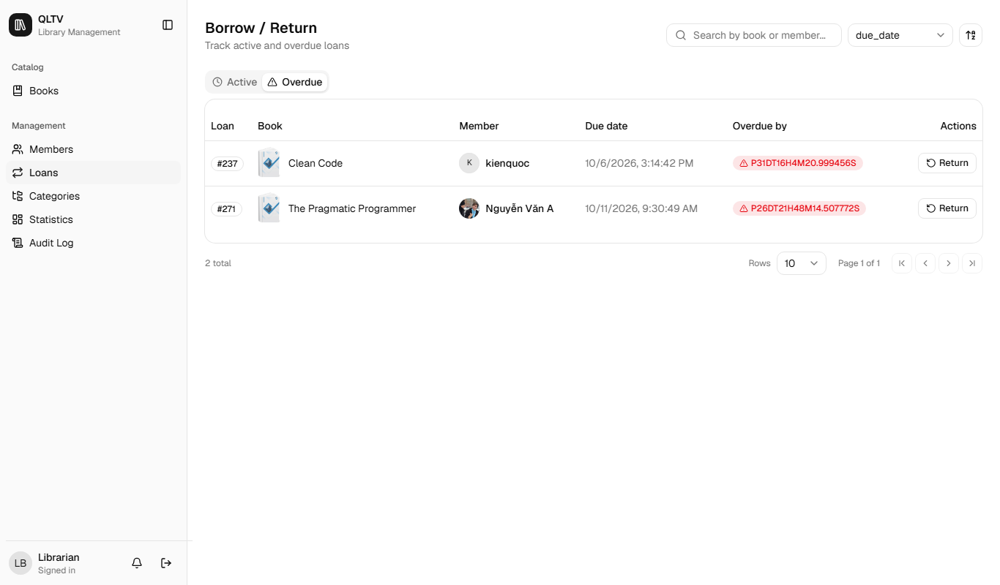

Khi độc giả mang sách về trả, bấm **Return** ở cuối dòng. Hệ thống hiện thông báo **Return recorded** và phiếu biến khỏi danh sách đang mượn.

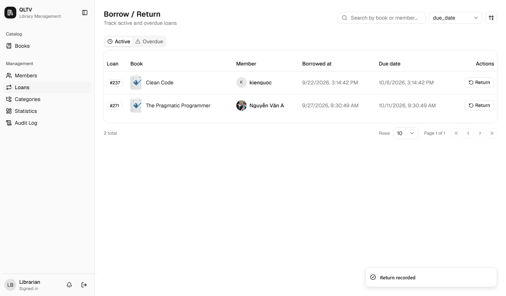

### 3.8. Thống kê (Statistics)

Trang **Statistics** hiển thị:

- Số liệu bộ nhớ đệm Redis: tỷ lệ trúng cache (**Cache hit ratio**), số lần trúng và trượt.
- **Most borrowed books**: sách được mượn nhiều nhất.
- **Most active members**: độc giả mượn nhiều nhất.

Nút **Refresh monthly report** làm mới báo cáo tháng (materialized view).

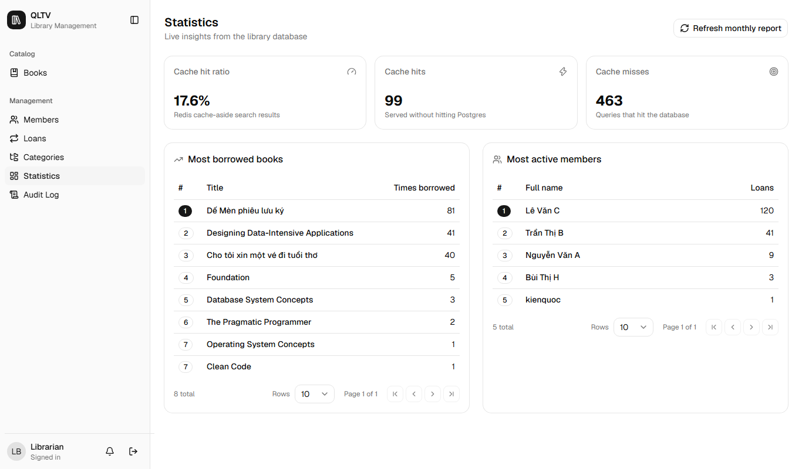

### 3.9. Nhật ký thay đổi (Audit Log)

Trang **Audit Log** ghi lại mọi thao tác thêm, sửa, xóa trên bảng sách và phiếu mượn. Mỗi dòng cho biết thời điểm, bảng, hành động, dòng bị tác động, **người thực hiện** và các trường đã đổi. Có thể lọc theo bảng (All tables / Books / Loans) và theo hành động (Insert / Update / Delete).

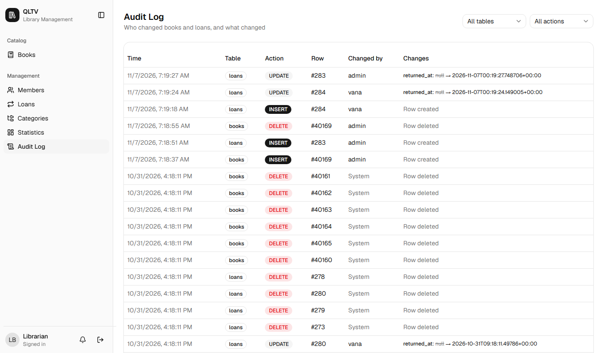

Bấm vào một dòng để xem dữ liệu **Before** (trước khi sửa) và **After** (sau khi sửa).

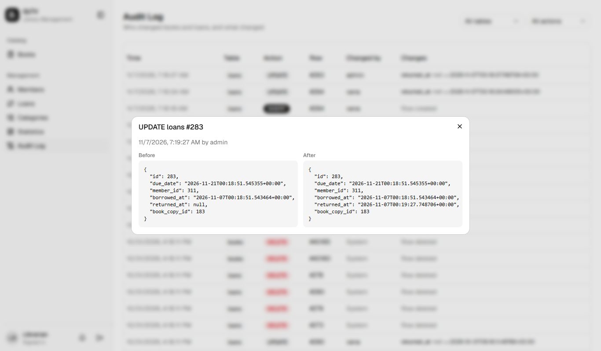

Cột **Changed by** hiện `System` với các thay đổi không đi qua ứng dụng (ví dụ dữ liệu mẫu hoặc câu lệnh SQL chạy tay).

## 4. Chức năng dành cho Member

### 4.1. Đăng nhập và xem sách

Đăng nhập bằng `vana` / `member123`. Menu của độc giả chỉ có **Books** và **My Loans**, không có nhóm Management.

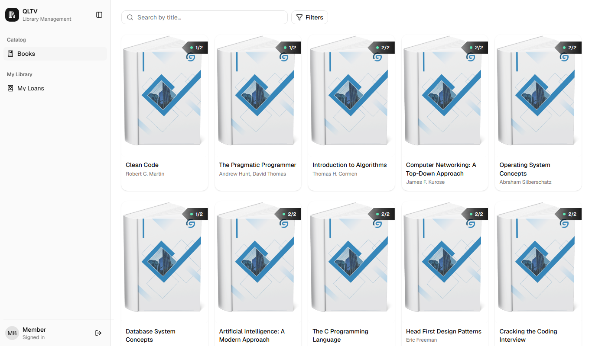

### 4.2. Tự mượn sách

Rê chuột lên sách, bấm **Borrow**. Người mượn luôn là chính tài khoản đang đăng nhập nên không cần chọn độc giả.

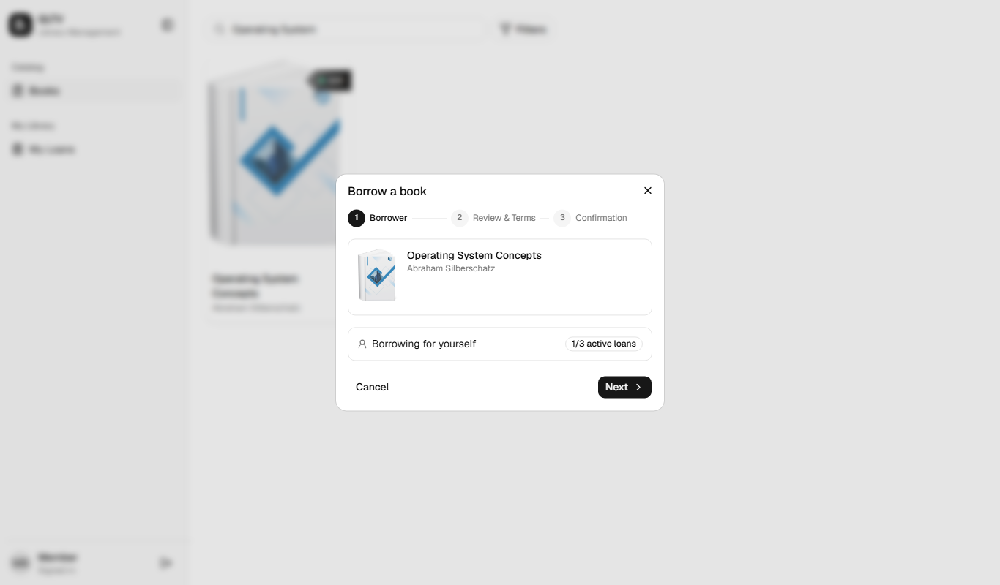

Bước tiếp theo xem điều khoản và tick đồng ý rồi bấm **Confirm borrow**.

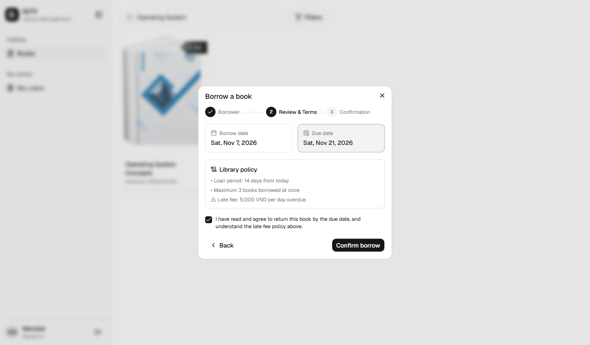

Quy định mượn sách:

- Mỗi độc giả mượn tối đa **3 cuốn** cùng lúc.
- Thời hạn mượn **14 ngày**.
- Trễ hạn bị phạt **5.000 VND mỗi ngày** (chỉ là thông tin hiển thị, hệ thống chưa tích hợp thanh toán).

### 4.3. Admin nhận thông báo theo thời gian thực

Khi một độc giả tự mượn sách, admin đang mở hệ thống nhận ngay một thông báo nhỏ ở góc màn hình, không cần tải lại trang.

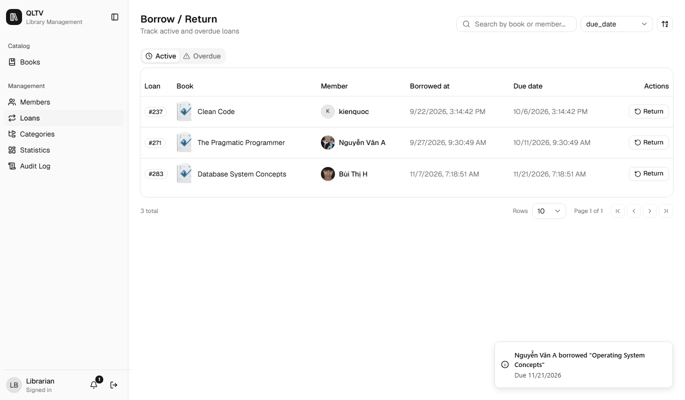

Biểu tượng chuông ở chân menu hiện số thông báo chưa đọc. Bấm vào chuông để xem danh sách, bấm vào một thông báo để mở chi tiết phiếu mượn tương ứng.

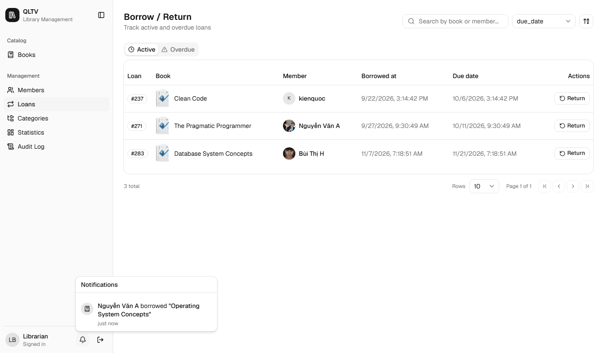

### 4.4. Xem và trả sách của mình (My Loans)

Trang **My Loans** liệt kê sách đang mượn (tab **Active**) và sách quá hạn (tab **Overdue**). Độc giả chỉ thấy phiếu của chính mình.

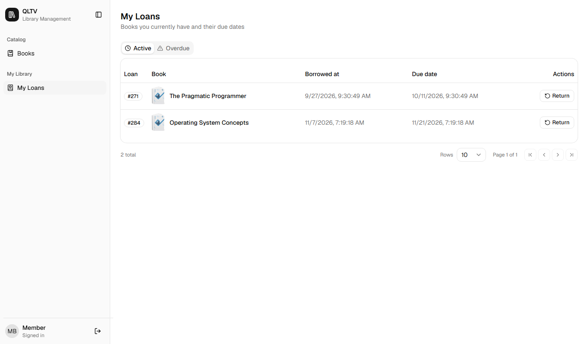

Bấm **Return** ở dòng sách cần trả.

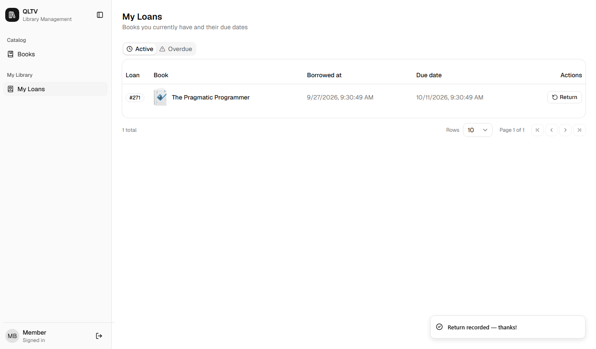

## 5. Hướng dẫn sử dụng API

Giao diện web chỉ là một client gọi API. Bạn có thể gọi trực tiếp API bằng Swagger UI, `curl`, Postman hoặc bất kỳ ngôn ngữ nào. Các ví dụ dưới đây đã được chạy thật trên bản demo và kết quả được rút gọn cho dễ đọc.

### 5.1. Thông tin chung

| Mục | Giá trị |
|---|---|
| Địa chỉ gọi trực tiếp | `http://localhost:8000` |
| Địa chỉ qua frontend | `http://localhost:5173/api/...` (frontend chuyển tiếp, bỏ tiền tố `/api`) |
| Tài liệu tương tác (Swagger UI) | `http://localhost:8000/docs` |
| Tài liệu ReDoc | `http://localhost:8000/redoc` |
| Đặc tả OpenAPI (JSON) | `http://localhost:8000/openapi.json` |
| Kiểm tra sống | `GET /health` trả `{"status":"ok"}` |
| Định dạng dữ liệu | JSON; thời gian theo ISO 8601, múi giờ UTC |

**Phân trang.** Mọi danh sách phân trang dùng chung tham số `page` (từ 1) và `page_size` (tối đa 100), kết quả có dạng:

```json
{ "items": [ ... ], "total": 2, "page": 1, "page_size": 1, "total_pages": 2 }
```

### 5.2. Xác thực

API dùng JWT. Access token sống **30 phút**, refresh token sống **7 ngày**. Endpoint cần đăng nhập thì gửi kèm header `Authorization: Bearer <access_token>`.

**Đăng nhập**

```bash
curl -X POST http://localhost:8000/auth/login \
  -H "Content-Type: application/json" \
  -d '{"username":"admin","password":"admin123"}'
```

```json
{ "access_token": "eyJhbGciOi...", "refresh_token": "fd054346f13e...", "token_type": "bearer" }
```

**Xem thông tin người đang đăng nhập**

```bash
curl http://localhost:8000/auth/me -H "Authorization: Bearer $TOKEN"
```

```json
{ "user_id": 1, "role": "admin", "member_id": null, "member_full_name": null, "member_email": null, "member_avatar_url": null }
```

**Làm mới token.** Khi access token hết hạn, đổi refresh token lấy cặp token mới. Mỗi refresh token chỉ dùng được **một lần** (rotation): dùng lại token cũ sẽ nhận lỗi 401.

```bash
curl -X POST http://localhost:8000/auth/refresh \
  -H "Content-Type: application/json" \
  -d '{"refresh_token":"<refresh_token>"}'
```

**Đăng xuất** thu hồi refresh token, trả `204` và không có nội dung:

```bash
curl -X POST http://localhost:8000/auth/logout \
  -H "Content-Type: application/json" \
  -d '{"refresh_token":"<refresh_token>"}'
```

### 5.3. Thử API bằng Swagger UI

1. Mở `http://localhost:8000/docs`. Các endpoint được nhóm theo chức năng (auth, books, loans...). Ổ khóa bên phải nghĩa là endpoint cần đăng nhập.

   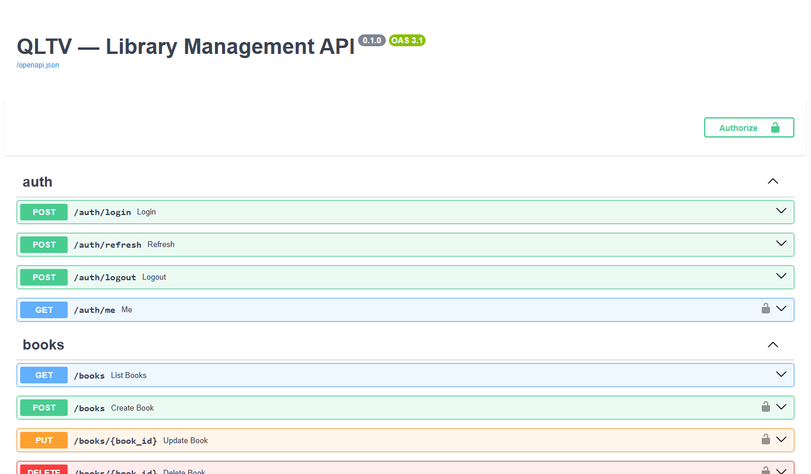

2. Mở `POST /auth/login`, bấm **Try it out**, nhập tài khoản và bấm **Execute**. Sao chép giá trị `access_token` trong phản hồi.
3. Bấm nút **Authorize** ở góc phải, dán access token vào ô **Value** (chỉ dán token, không gõ chữ `Bearer`), bấm **Authorize**. Từ giờ mọi request trong trang đều tự gửi kèm token.

   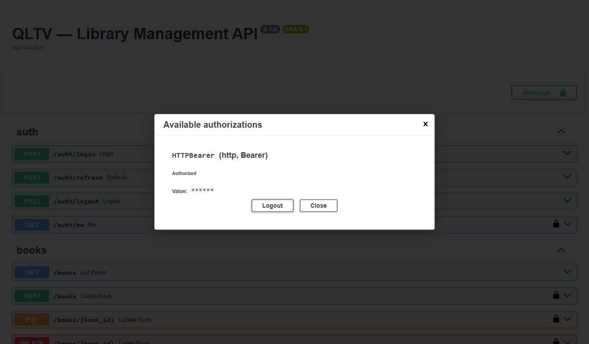

4. Mở endpoint muốn thử, bấm **Try it out**, điền tham số rồi **Execute**. Swagger hiện luôn lệnh `curl` tương ứng, tiện để sao chép.

### 5.4. Danh sách endpoint

Cột **Quyền**: *Công khai* là không cần đăng nhập; *Đăng nhập* là admin hoặc member; *Admin* là chỉ admin.

**Xác thực**

| Method | Đường dẫn | Quyền | Mô tả |
|---|---|---|---|
| POST | `/auth/login` | Công khai | Đăng nhập, trả cặp token |
| POST | `/auth/refresh` | Công khai | Đổi refresh token lấy cặp token mới |
| POST | `/auth/logout` | Công khai | Thu hồi refresh token |
| GET | `/auth/me` | Đăng nhập | Thông tin tài khoản hiện tại |

**Sách**

| Method | Đường dẫn | Quyền | Mô tả |
|---|---|---|---|
| GET | `/books` | Công khai | Tìm kiếm, lọc, sắp xếp, phân trang sách |
| POST | `/books` | Admin | Tạo sách kèm tác giả và số bản sao |
| PUT | `/books/{id}` | Admin | Sửa sách (trường nào gửi lên mới đổi) |
| DELETE | `/books/{id}` | Admin | Xóa sách; `409` nếu sách đã có lịch sử mượn |
| GET | `/books/{id}/copies` | Admin | Liệt kê bản sao và trạng thái |
| POST | `/books/{id}/copies` | Admin | Thêm bản sao, body `{"count": 2}` |
| PATCH | `/books/{id}/copies/{copy_id}` | Admin | Đổi trạng thái bản sao: `available`, `lost`, `damaged` |

Tham số của `GET /books`: `search` (tìm toàn văn theo tên), `category_id`, `available_only` (true/false), `sort_by` (`title`, `created_at`, `available_copies`), `sort_dir` (`asc`, `desc`), `page`, `page_size`.

**Tác giả, thể loại, độc giả**

| Method | Đường dẫn | Quyền | Mô tả |
|---|---|---|---|
| GET | `/authors` | Công khai | Toàn bộ tác giả |
| POST | `/authors?full_name=...` | Admin | Thêm tác giả (tên truyền qua query string) |
| GET | `/categories` | Công khai | Toàn bộ thể loại |
| POST | `/categories` | Admin | Thêm thể loại, body `{"name": "...", "parent_id": null}` |
| PUT | `/categories/{id}` | Admin | Sửa tên và thể loại cha |
| DELETE | `/categories/{id}` | Admin | Xóa; `409` nếu còn thể loại con hoặc còn sách |
| GET | `/members` | Công khai (*) | Danh sách độc giả, tham số `search`, `sort_by` (`full_name`, `joined_at`), `sort_dir`, `page`, `page_size` |
| POST | `/members` | Admin | Thêm độc giả; gửi kèm `username` và `password` để tạo luôn tài khoản |

(*) `GET /members` hiện chưa yêu cầu đăng nhập. Khi triển khai thật nên khóa lại vì có chứa email và số điện thoại.

**Phiếu mượn**

| Method | Đường dẫn | Quyền | Mô tả |
|---|---|---|---|
| GET | `/loans/policy` | Công khai | Nội quy: 14 ngày, tối đa 3 cuốn, phạt 5.000 VND/ngày |
| POST | `/loans/borrow` | Đăng nhập | Mượn sách. Admin phải gửi `member_id`; member luôn mượn cho chính mình |
| POST | `/loans/{id}/return` | Đăng nhập | Trả sách. Member chỉ trả được phiếu của mình |
| GET | `/loans/{id}` | Đăng nhập | Chi tiết một phiếu. Member chỉ xem được phiếu của mình |
| GET | `/loans` | Đăng nhập | Danh sách phiếu, tham số `status` (`borrowed`, `returned`, `overdue`), `search`, `sort_by` (`due_date`, `borrowed_at`), `sort_dir`, `page`, `page_size`. Member chỉ thấy phiếu của mình |

**Thống kê, audit, upload**

| Method | Đường dẫn | Quyền | Mô tả |
|---|---|---|---|
| GET | `/stats/top-books` | Công khai | Sách được mượn nhiều nhất (view `v_top_borrowed_books`) |
| GET | `/stats/active-members` | Công khai | Độc giả mượn nhiều nhất (view `v_active_members`) |
| GET | `/stats/cache` | Công khai | Số lần cache Redis trúng và trượt |
| POST | `/stats/refresh-monthly` | Công khai (*) | Làm mới báo cáo tháng (materialized view) |
| GET | `/audit-logs` | Admin | Nhật ký thay đổi; tham số `table_name` (`books`, `loans`), `operation` (`INSERT`, `UPDATE`, `DELETE`), `row_id`, `date_from`, `date_to`, `page`, `page_size` |
| POST | `/uploads/cover` | Admin | Upload ảnh bìa (`multipart/form-data`, trường `file`) |
| WS | `/ws/notifications?token=...` | Admin | Kênh thông báo thời gian thực |

(*) `POST /stats/refresh-monthly` hiện cũng chưa yêu cầu đăng nhập.

### 5.5. Ví dụ theo kịch bản

Các lệnh sau giả định biến `TOKEN` chứa access token của admin (lấy ở mục 5.2).

**Tìm sách**

```bash
curl "http://localhost:8000/books?search=Foundation&page_size=1"
```

```json
{
  "items": [{
    "id": 7, "title": "Foundation", "isbn": "978-0000000003", "category_id": 5,
    "cover_url": "/static/covers/1465ebd5619044f391f4b17f9d33b4c9.png",
    "created_at": "2026-09-22T05:23:21.776096Z",
    "authors": [{ "id": 7, "full_name": "Isaac Asimov" }],
    "available_copies": 1, "total_copies": 1
  }],
  "total": 1, "page": 1, "page_size": 1, "total_pages": 1
}
```

**Tạo, sửa, xóa sách** (cần admin)

```bash
# Tạo
curl -X POST http://localhost:8000/books \
  -H "Authorization: Bearer $TOKEN" -H "Content-Type: application/json" \
  -d '{"title":"API Demo Book","isbn":"API-DEMO-1","author_ids":[],"copies_count":1}'

# Sửa (chỉ gửi trường cần đổi)
curl -X PUT http://localhost:8000/books/40170 \
  -H "Authorization: Bearer $TOKEN" -H "Content-Type: application/json" \
  -d '{"title":"API Demo Book v2"}'

# Xóa, trả 204
curl -X DELETE http://localhost:8000/books/40170 -H "Authorization: Bearer $TOKEN"
```

Trường `author_ids` là danh sách id tác giả lấy từ `GET /authors`; `copies_count` là số bản sao tạo kèm.

**Mượn và trả sách**

Admin mượn hộ cần `member_id`. Member tự mượn chỉ cần `book_id`:

```bash
curl -X POST http://localhost:8000/loans/borrow \
  -H "Authorization: Bearer $MEMBER_TOKEN" -H "Content-Type: application/json" \
  -d '{"book_id": 40129}'
```

```json
{ "id": 285, "book_copy_id": 182, "member_id": 4,
  "borrowed_at": "2026-11-07T00:30:45.812591Z", "due_date": "2026-11-21T00:30:45.814196Z", "returned_at": null }
```

```bash
curl -X POST http://localhost:8000/loans/285/return -H "Authorization: Bearer $MEMBER_TOKEN"
```

Phản hồi giống phiếu ở trên nhưng `returned_at` đã có giá trị. Trả lại lần nữa sẽ nhận `409 Loan already returned`.

**Xem audit log của một cuốn sách** (cần admin)

```bash
curl "http://localhost:8000/audit-logs?table_name=books&row_id=40170" \
  -H "Authorization: Bearer $TOKEN"
```

Kết quả có hai dòng, mới nhất trước: `UPDATE` rồi `INSERT`, cùng có `changed_by_username` là `admin`. Mỗi dòng kèm `old_data` và `new_data` là ảnh chụp dòng dữ liệu trước và sau khi sửa.

**Thống kê**

```bash
curl "http://localhost:8000/stats/top-books?page_size=1"
```

```json
{ "items": [{ "id": 6, "title": "Dế Mèn phiêu lưu ký", "times_borrowed": 81, "rank": 1 }],
  "total": 8, "page": 1, "page_size": 1, "total_pages": 8 }
```

```bash
curl http://localhost:8000/stats/cache
# {"hits":100,"misses":467,"hit_ratio":0.1764}
```

### 5.6. Upload ảnh bìa

```bash
curl -X POST http://localhost:8000/uploads/cover \
  -H "Authorization: Bearer $TOKEN" -F "file=@bia-sach.png"
# {"url":"/static/covers/<ten-ngau-nhien>.png"}
```

Chỉ nhận ảnh PNG, JPEG, WEBP, GIF và tối đa 5 MB. Dùng giá trị `url` trả về làm `cover_url` khi tạo hoặc sửa sách. Ảnh được phục vụ công khai tại `http://localhost:8000/static/covers/...`.

### 5.7. Thông báo thời gian thực (WebSocket)

Admin kết nối tới `ws://localhost:8000/ws/notifications?token=<access_token>`. Trình duyệt không gửi được header cho WebSocket nên token đi qua query string. Mỗi khi một member tự mượn sách, server đẩy một tin nhắn JSON xuống kết nối đó. Thử nhanh bằng công cụ `websocat` hoặc `wscat`:

```bash
wscat -c "ws://localhost:8000/ws/notifications?token=$TOKEN"
```

Token sai thì server đóng kết nối với mã `4401`, tài khoản không phải admin thì mã `4403`.

### 5.8. Mã lỗi thường gặp

Lỗi trả về dạng `{"detail": "thông báo"}`.

| Mã | Ý nghĩa | Ví dụ |
|---|---|---|
| 401 | Sai thông tin đăng nhập, token hết hạn hoặc không hợp lệ | `Invalid username or password`, `Invalid or expired refresh token` |
| 403 | Chưa gửi token, hoặc không đủ quyền | `Not authenticated` (thiếu header), `Admin role required` (member gọi endpoint admin), `You can only return your own loans` |
| 404 | Không tìm thấy | `Book not found`, `Loan not found` |
| 409 | Xung đột nghiệp vụ | `No available copy for this book`, `Member already has 3 active loans`, `Loan already returned`, `Username already taken` |
| 413 | Ảnh upload quá 5 MB | `Image must be smaller than 5MB` |
| 422 | Dữ liệu gửi lên không hợp lệ | thiếu trường bắt buộc, `username and password must be provided together` |

Lưu ý: khi **không gửi header Authorization**, hệ thống trả `403 Not authenticated` (không phải 401). Mã 401 chỉ xuất hiện khi token có gửi nhưng sai hoặc hết hạn.

### 5.9. Chạy bộ kiểm thử tự động

Bộ test gọi API thật trên CSDL đang chạy (cần stack Docker đã chạy và đã có dữ liệu mẫu):

```bash
docker compose exec backend python -m pytest -q
```

Gồm 18 test: luồng mượn trả, giới hạn 3 cuốn, quyền của member, ghi audit log và test tương tranh (10 request cùng mượn cuốn sách chỉ còn 1 bản sao, đúng 1 request thành công).

## 6. Các kỹ thuật CSDL thể hiện qua giao diện

| Chức năng trên giao diện | Kỹ thuật CSDL đứng sau |
|---|---|
| Nhiều người cùng mượn bản sao cuối cùng | `SELECT ... FOR UPDATE SKIP LOCKED` trong transaction, chỉ một người mượn được |
| Số bản sao rảnh tự đổi khi mượn và trả | Trigger `fn_after_loan_insert`, `fn_after_loan_return` |
| Tìm sách theo tên | Cột `tsvector` có trigger cập nhật tự động và chỉ mục GIN |
| Tab Overdue, bảng xếp hạng | View `v_overdue_loans`, `v_top_borrowed_books`, `v_active_members` |
| Báo cáo tháng | Materialized view `mv_monthly_stats` |
| Cache hit ratio | Cache-aside bằng Redis cho kết quả tìm kiếm |
| Audit Log | Trigger `fn_audit_books`, `fn_audit_loans` ghi dữ liệu trước và sau dưới dạng JSONB, người thực hiện lấy từ biến phiên `app.user_id` |
| Thông báo thời gian thực | Redis Pub/Sub kết hợp WebSocket |
